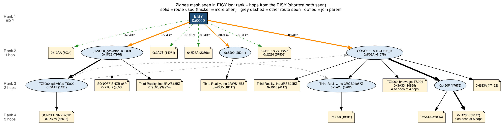
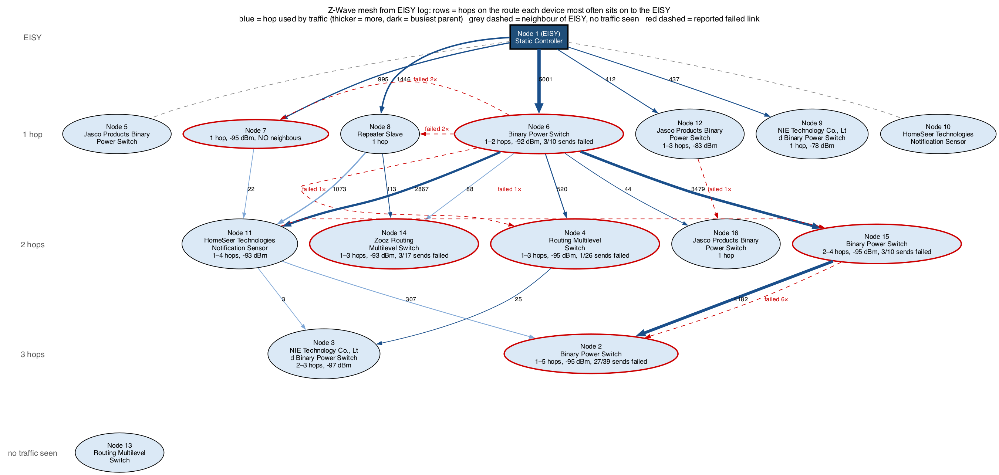

# Eisy scripts

Random scripts for [Eisy](https://www.universal-devices.com/) home automation controllers

## eisy_zb_decode.py

&nbsp; &nbsp; &nbsp; A quick Python script to decode Zigbee protocol from Easy logs

## eisy_zb_graph.py

&nbsp; &nbsp; &nbsp; Script to generate a visual graph of Zigbee network

## eisy_zw_decode.py

&nbsp; &nbsp; &nbsp;  A quick Python script to decode ZWave protocol from Easy logs

## eisy_zw_graph.py

&nbsp; &nbsp; &nbsp; Script to generate a visual graph of ZWave network
